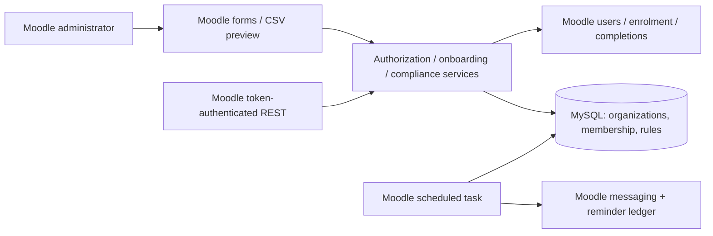

# FleetCert — Moodle Training Compliance

FleetCert is a native Moodle local plugin for tracking organization-specific training requirements in logistics and industrial teams. It uses Moodle accounts, manual enrolment, course completion, messaging, scheduled tasks, capabilities and External Services. It tracks **simulated training compliance**, not legally recognized certifications.

This initial portfolio release implements a compact working design. Runtime integration has **not been verified** in the authoring environment: PHP was unavailable and Docker Desktop could not start. The included tests have not been executed. Review and test before using with real employee information.

## Architecture



## Stack and compatibility

- Moodle **4.5.15 LTS**, official `v4.5.15` source tag; upstream commit `215f44380bdc3ccf852a3a22e34f8423ff64033a`
- PHP 8.3 / Apache, MySQL 8.0, Docker Compose v2
- Moodle XMLDB, DML, Forms, External Services, messaging and lock APIs
- PHPUnit tests using Moodle's test harness; GitHub Actions PHP syntax checks

Moodle 4.5 security support runs through October 4, 2027. See [official compatibility requirements](https://moodledev.io/general/releases/4.5). The Docker base image receives PHP patch updates; this is a local development environment, not hardened hosting.

## Run locally

```sh
git clone https://github.com/zinels/fleetcert-moodle-compliance.git
cd fleetcert-moodle-compliance
cp .env.example .env
# Edit .env and replace both password placeholders.
docker compose up -d --build
docker compose exec --user www-data moodle php admin/cli/install_database.php --agree-license --adminuser=admin --adminpass='ChooseYourOwnStrongPassword!42' --adminemail=admin@example.invalid --fullname=FleetCert --shortname=FleetCert
# Enable completion tracking in Site administration > Advanced features.
docker compose exec -e FLEETCERT_DEMO=1 --user www-data moodle php local/fleetcert/cli/seed.php
```

Open [Moodle locally](http://localhost:8080), sign in with the admin account you selected, then visit `/local/fleetcert/index.php`. Do not use the illustrative administrator password on a shared deployment. Keep `.env` private.

For an existing Moodle 4.5 installation, copy `local/fleetcert` into its `local/` directory, then run `php admin/cli/upgrade.php --non-interactive` as the web-server user.

## Demo walkthrough

1. Select one of three synthetic organizations to view its aggregate compliance counts and requirements.
2. Open Training records to see incomplete, compliant, expired and expiring records. CSV exports contain the current 100-row page. Add `courseid=ID` to the report URL to filter a course.
3. Upload `sample-data/employees.csv` in Bulk onboarding. Preview shows the duplicate and malformed-email errors. Commit imports valid rows and shows row results; the results download contains row numbers and outcomes only.
4. Re-upload the same valid CSV to exercise retry behavior. Accounts must already belong to the same organization and match the email to be reused.
5. As site administrator, configure another organization or upsert a course rule. Reminder days must be less than positive validity days. No customer names appear in the rules engine.

The CLI seed creates 1,000 synthetic employees across three organizations with three required courses each. Domains use `example.invalid`. Repeated seeds reuse identities and existing completion records. It deliberately inserts simulated historical completions using Moodle's completion API; it is only for disposable development instances. The CSV fixture separately demonstrates duplicate and invalid input. Conflicting reminder settings are rejected by form and rules-service validation.

## Rules and data design

`local_fleetcert_org` holds organization names; `member` maps employees to exactly one organization; `manager` maps authorized managers to organizations; `rule` has one course requirement per organization; `notice` deduplicates reminders per organization, employee, course and expiration. XMLDB defines keys and unique indexes. Course completions remain in Moodle's `course_completions` table.

Validity is a fixed number of 24-hour days from Moodle's completion timestamp. At the exact expiration timestamp the record is expired. Expiring records remain compliant until expiration. An employee is compliant when every required course has an unexpired completion. Organizations without requirements show zero compliant employees rather than a misleading positive result. Suspended/deleted accounts are excluded from reports.

Renewal is administrator-managed: a distinct renewal course can be configured, or a separately managed Moodle completion-reset workflow can establish a new completion. This plugin does not erase completion history or automatically reset courses. Reminder frequency is one successful notification per completion expiration; the configured window determines when it becomes eligible.

## Tenant access and security

Site administrators can access all organizations. Other users need both a Moodle system capability (`local/fleetcert:view` or `local/fleetcert:manage`) and a corresponding `local_fleetcert_manager` assignment. The initial UI reserves rule editing for site administrators. Organization-manager assignments are currently provisioned by a trusted site administrator through a migration or Moodle DML script; there is no assignment editor yet.

Moodle forms validate session keys for configuration and uploads; committing previews explicitly requires a POST and session key. DML uses bound parameters. UI fields are escaped. Exports neutralize formula prefixes. Onboarding uses a Moodle lock and a database transaction per row: failed rows roll back while other rows proceed. Existing unrelated accounts are never adopted from CSV. Generated passwords never appear in results; users must use Moodle's password-reset process before their first login. Use real routable email addresses outside the synthetic demo.

Moodle events record configuration and successful onboarding actions. This demonstrates controls relevant to audited environments but makes no SOC 2 compliance or certification claim. Configure log retention, backups, HTTPS and least-privilege service accounts for actual deployment. A full Moodle Privacy API export/deletion provider remains future work; this release must not be used for production personal data.

## REST API

Enable web services and the REST protocol in Moodle. Enable the disabled-by-default **FleetCert integration** service, authorize a dedicated user, grant the view capability and organization assignment, and issue that user's token through Moodle administration. Never use the site-administrator token in an integration.

```sh
curl --request POST 'http://localhost:8080/webservice/rest/server.php' \
  --data-urlencode "wstoken=$MOODLE_TOKEN" \
  --data-urlencode 'wsfunction=local_fleetcert_records' \
  --data-urlencode 'moodlewsrestformat=json' \
  --data-urlencode 'orgid=1' \
  --data-urlencode 'page=0' \
  --data-urlencode 'limit=100' \
  --data-urlencode 'userid=0' \
  --data-urlencode 'courseid=0'
```

Response records contain only `userid`, `courseid`, `status`, `issued` and `expires` (Unix timestamps, zero for missing completion). Pages are zero based, maximum 500 records. Employee and course filters are optional. Tenant authorization runs before every query. Organization summaries currently exist in the UI service; dedicated summary and expired-only external functions are not implemented. Clients can filter record statuses while paging.

## Scheduled reminders

Run Moodle cron every minute on your deployment, or manually for the demo:

```sh
docker compose exec --user www-data moodle php admin/cli/cron.php
```

The task runs daily at 06:17 in the Moodle scheduler. Configure an outgoing mail transport to deliver email. No cron sidecar is included. The lock and unique reminder ledger prevent duplicates on ordinary repeated runs. A process crash after message dispatch but before ledger insertion can cause a duplicate on retry; exactly-once delivery is not claimed.

## Testing and change workflow

`local/fleetcert/tests/compliance_test.php` covers expiry boundaries, invalid configurations, CSV validation, formula escaping and capability denial. These tests were written but **not run** here. CI currently checks syntax only, not database integration. To run the Moodle tests in a disposable development instance:

1. Install Composer development dependencies in the Moodle container (`composer install` from `/var/www/html`; install Composer there first).
2. Configure `$CFG->phpunit_prefix = 'phpu_';` and `$CFG->phpunit_dataroot = '/var/www/phpunitdata';` in a local config override, create that writable directory, and run `php admin/tool/phpunit/cli/init.php`.
3. Run `vendor/bin/phpunit --testsuite local_fleetcert_testsuite`.

Do not point test configuration at production. Use a feature branch and PR, inspect the syntax workflow, run the Moodle tests and exercise upload, tenant denial and reminders before merging. Deploy a reviewed plugin directory, back up the database, run Moodle CLI upgrade and monitor cron. Add migration steps and increment `version.php` for schema changes.

## Engineering Challenges and Lessons Learned

- Keeping customer logic configurable led to one requirement row per organization/course and a pure timestamp evaluator. The same evaluator drives reports and reminders, avoiding competing definitions of expiration.
- Safe retries required more than checking a username: onboarding also checks existing tenant membership and email before reusing an account. A row transaction prevents partial enrolments from surviving a failed row.
- Tenant isolation needed an explicit organization assignment in addition to Moodle's broad system capabilities. A central guard keeps UI and external reads consistent.
- Moodle already owns authentication, enrolment and completion. Using those APIs avoided a parallel account or certification database, but also means renewal must respect Moodle's existing completion lifecycle.
- The local authoring environment had no PHP runtime and Docker Desktop would not launch. Consequently integration behavior remains unverified; no benchmark or passing-test claim is made.

## What I Would Change in Version 2

Add a proper recurring-course renewal model with immutable issuance history instead of relying on one current Moodle completion; implement a Privacy API provider and retention policy; add a manager-assignment editor; move onboarding to an ad-hoc task with persistent import batches and expiry; use aggregate SQL for large summaries; add status/date filters and complete streamed exports; implement all dedicated external functions; expand integration tests for row rollback, cross-tenant privileged users, API tokens and crash recovery; and run MySQL-backed Moodle PHPUnit in CI.

## Known limitations

This is an alpha portfolio implementation. No legal certification, performance measurements, completed runtime verification, production privacy support, automated renewal reset, full audit export or 100%-exactly-once messaging is claimed. Reporting uses paginated queries and PHP aggregation. Concurrent configuration updates are not versioned. Preview data lives in the Moodle session until replaced or logout. README demo instructions substitute for screenshots of an unverified runtime.

Licensed GPL-3.0-or-later, compatible with Moodle's plugin ecosystem.
