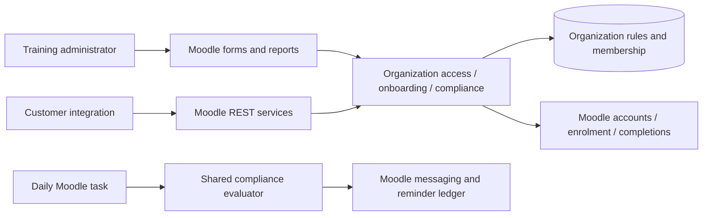

# FleetCert
### Training records that answer the safety team's next question.

[](https://github.com/zinels/fleetcert-moodle-compliance/actions/workflows/php.yml)
[](https://github.com/zinels/fleetcert-moodle-compliance/actions/workflows/moodle.yml)

FleetCert is a **native Moodle plugin** for tracking required employee training across multiple organizations. It helps a training administrator answer three practical questions: **Who is up to date? What is about to expire? Who still needs training?**

Each organization chooses its required courses, how long a completion stays valid, and when reminders should begin. Moodle remains responsible for accounts, enrolments, and course completions; FleetCert adds the rules, reporting, onboarding, and organization boundaries around them.

**Status: 0.2.0 · portfolio alpha · synthetic data only.** This is a training-compliance prototype, not a certification authority or a production-ready employee system. The test badges link to executable checks; see [verification and limits](#verification-and-limits) for what they establish.

## What you can do

- **Configure requirements:** choose existing Moodle courses and set validity/reminder periods per organization, without adding customer-specific code.
- **Onboard employees in bulk:** upload a CSV, review validation errors, and import valid rows. Accounts are created and enrolled through Moodle APIs. Retry checks prevent an unrelated account from being adopted.
- **Find training gaps:** review organization totals, then filter records by employee, course, or status. Export **all matching records**, rather than just the visible page.
- **Control organization access:** site administrators assign and remove organization managers in the UI. Other users need both an assignment and the appropriate Moodle capability.
- **Integrate records:** use Moodle's token-authenticated REST service for paginated training records and organization summaries.
- **Send reminders:** a daily scheduled task notifies employees about expiring or expired training and records successful sends to avoid ordinary duplicate notifications.

## A quick walkthrough

1. Create a disposable local instance using the setup below.
2. Enable completion tracking, then run the demo seed. It is designed to create **1,000 synthetic employees, three organizations, and three courses**, with a mix of training states.
3. Visit **`/local/fleetcert/index.php`** and select an organization. Review the totals and course requirements.
4. Open **Training records**, choose a status/course/employee filter, and export the matching records.
5. Try **Bulk onboarding** with `sample-data/employees.csv`. Preview identifies malformed emails and duplicates before import. Uploading the same valid employees again exercises the retry policy.
6. As site administrator, open **Manage organization managers**. Assign an existing Moodle user who has a system role granting `local/fleetcert:view` and, if needed, `local/fleetcert:manage`. Organization assignment alone does not grant those capabilities.

## How the rules work

A completion is valid for the organization's configured number of **24-hour days**. At its exact expiry timestamp it is **expired**; inside the reminder window it is **expiring** but still valid. A missing or future-dated completion is **incomplete**. Otherwise it is **compliant**.

An employee counts as compliant only when every required course is still valid. Organizations with no configured requirements show zero compliant employees, avoiding a misleading positive result. Deleted and suspended Moodle users are excluded.

Renewal is currently administrator-managed. FleetCert does not reset courses or keep an immutable history of repeated training cycles. That requires an explicit renewal model, rather than silently overwriting Moodle's current completion record.

## Architecture



The plugin lives in **`local/fleetcert`**. Five plugin tables hold organizations, employee memberships, manager assignments, course rules, and reminder history. Moodle is the source of truth for employee accounts and course completions. UI reports, summaries, and reminders use the same timestamp evaluator.

The code targets **Moodle 4.5.15, PHP 8.3, and MySQL 8.0**. The Docker environment is for local development; it does not configure production hosting or mail delivery.

## Run locally

Requires Docker with Compose v2. Use a disposable instance and synthetic data.

```sh
git clone https://github.com/zinels/fleetcert-moodle-compliance.git
cd fleetcert-moodle-compliance
cp .env.example .env
# Replace the password placeholders in .env before continuing.
docker compose up -d --build
```

Install Moodle using your own administrator password:

```sh
docker compose exec --user www-data moodle \
  php admin/cli/install_database.php --agree-license \
  --adminuser=admin --adminpass='REPLACE_WITH_YOUR_OWN_PASSWORD' \
  --adminemail=admin@example.invalid --fullname=FleetCert --shortname=FleetCert
```

Open [localhost:8080](http://localhost:8080), sign in, and enable **Site administration → Advanced features → Enable completion tracking**. Then generate the demo:

```sh
docker compose exec -e FLEETCERT_DEMO=1 --user www-data moodle \
  php local/fleetcert/cli/seed.php
```

For an existing Moodle 4.5 installation, copy `local/fleetcert` into its `local/` directory and run `php admin/cli/upgrade.php --non-interactive` as the web-server user. Back up the database before upgrading an existing instance.

## REST integration

Enable Moodle web services and the REST protocol. Enable the disabled-by-default **FleetCert integration** service, authorize a dedicated user, and issue its token. That user needs the view capability and an assignment to the organization being queried. Avoid administrator tokens.

```sh
curl --request POST 'http://localhost:8080/webservice/rest/server.php' \
  --data-urlencode "wstoken=$MOODLE_TOKEN" \
  --data-urlencode 'wsfunction=local_fleetcert_records' \
  --data-urlencode 'moodlewsrestformat=json' \
  --data-urlencode 'orgid=1' \
  --data-urlencode 'status=expired' \
  --data-urlencode 'page=0' \
  --data-urlencode 'limit=100'
```

Record filters: `userid`, `courseid`, and `status` (`compliant`, `incomplete`, `expired`, `expiring`, or empty for all). Filtering occurs **before pagination**; pages start at zero and have at most 500 rows. Responses contain user/course IDs, status, completion timestamp, and expiry timestamp; missing timestamps are zero.

For organization totals, use **`local_fleetcert_summary`** with `orgid`. It returns employee totals, compliant employee count, whether requirements are configured, and training-record counts by status. A person and a training record are different counting units.

## Verification and limits

Run the dependency-free checks with `php tests/smoke.php`. They test expiry boundaries, future completions, invalid settings, and spreadsheet formula escaping; they do **not** substitute for Moodle integration tests.

The **Moodle integration** workflow installs a disposable Moodle 4.5.15/MySQL 8.0 environment and runs the plugin's PHPUnit suite on PHP 8.3. Tests cover filtered pagination, summaries, exports beyond 100 rows, privileged cross-organization denial, manager assignments, onboarding retries/rollback, and reminder reruns. The workflow badge links to the actual result, not a guarantee about every deployment.

For local PHPUnit setup and operational checks, see **[development and verification](docs/development.md)**.

Controls include organization-scoped authorization, form session keys, parameter validation, bound queries, escaped HTML, formula-safe CSVs, per-row onboarding transactions, and audit events. A reminder ledger protects ordinary reruns; a crash between message delivery and recording success can still cause a duplicate.

**Remaining work:** Moodle Privacy API export/deletion and retention, recurring-training history, persistent background import batches, date-range filters, and broader browser/token-level testing. The Privacy API provider is not implemented, so **do not load production employee data**. Local Docker startup, browser flows, external mail delivery, and the 1,000-employee demo must also be verified in the deployment environment; automated service tests do not establish those behaviors.

## Design decisions

- **Use Moodle's building blocks.** A separate identity or completion store would create competing sources of truth.
- **Configure customer differences.** Organization/course rules replace hard-coded customer branches.
- **Make retries safe.** Matching a username is insufficient: account reuse also requires matching email and existing membership in the same organization.
- **Separate capabilities from scope.** A broad Moodle permission does not automatically grant access to every customer.
- **Keep exports useful.** A safety report needs every matching record, even when the on-screen view is paginated.

Licensed **GPL-3.0-or-later**. All included employee data is synthetic.
